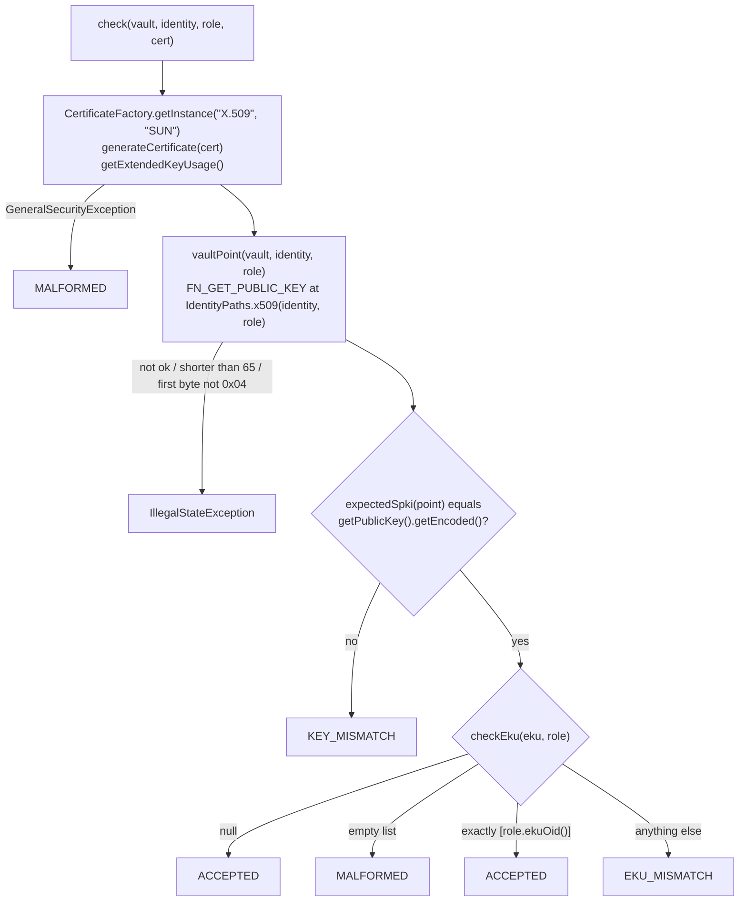
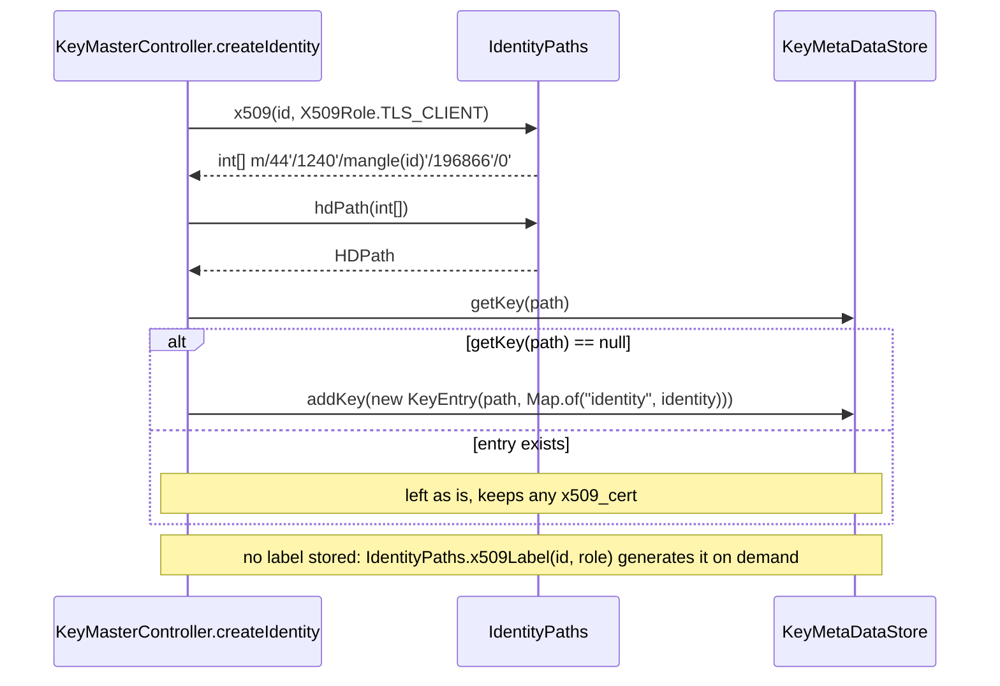
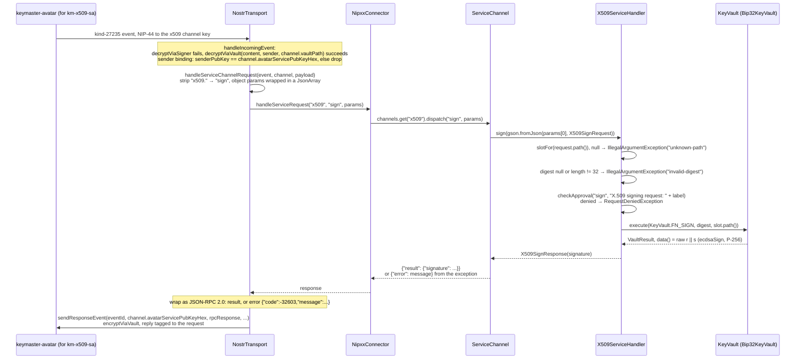
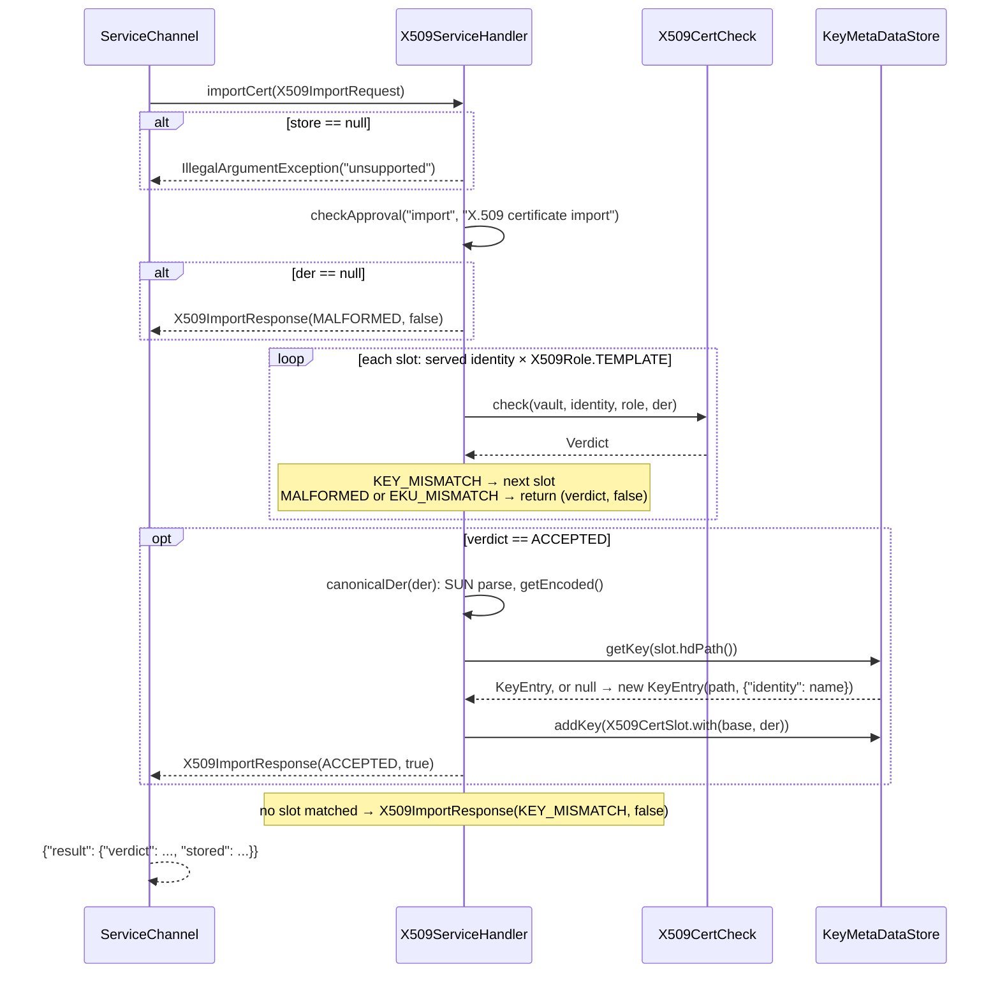
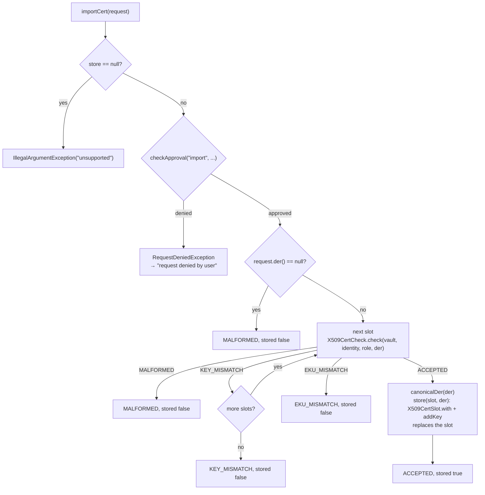

# X.509 Keys in KeyMaster Core

Status: As built — missions 37.1.2 and 37.1.3, on desktop KeyMaster. X.509
keys on the phone arrive with mission 37.2; see [Later Missions](#later-missions).

KeyMaster derives X.509 keys (P-256) from the same seed and identity as its
SSH, OpenPGP and Nostr keys.

- **37.1.2** added the paths, the generated labels, a JDK-only check that a
  certificate carries the vault's key, and a metadata slot for the
  certificate.
- **37.1.3** serves these keys over the `"x509"` service channel
  (`x509.list`, `x509.sign`, `x509.import`); see [X.509 Service](#x509-service).
  `x509.import` fills the slot. The enrolment in 37.1.5 is its first user.

"Certificate" in this document means an X.509 certificate. OpenPGP
certificates (`GpgPublicCert`, `OpenPgpCertBuilder`) are unrelated.

## Scope

The `"x509"` service has three operations:

1. `x509.list`
2. `x509.sign`
3. `x509.import`

KeyMaster owns the keys, their paths and labels, user approval, ECDSA
signing in the vault, and the check that decides whether a certificate is
stored. The service avatar [km-x509-sa](#service-avatar-km-x509-sa) checks
parameters and forwards requests. The [PKCS#11 module](#pkcs11-object-model)
presents the results as token objects.

Outside this service: building certificates (see
[Certificates Are Read, Not Built](#certificates-are-read-not-built)),
judging a certificate's chain, issuer, dates or revocation, roles other than
`TLS_CLIENT`, and X.509 on the phone (37.2).

## Code Map

All classes are in `club.dwdc.keymaster.core`, package `club.dwdc.keymaster`.

| Code | Responsibility |
|---|---|
| `X509Role` | The one role table: path role byte, label token, EKU OID |
| `IdentityPaths.x509(Identity, X509Role)` | The frozen derivation path of an X.509 key |
| `IdentityPaths.x509Label(Identity, X509Role)` | The generated label `"<identity> <token>"` |
| `X509CertCheck` | Checks a certificate against the vault key at the path; never builds one |
| `X509CertSlot` | Reads and writes the `x509_cert` metadata key of a `KeyEntry` |
| `X509Role.TEMPLATE` | `List.of(TLS_CLIENT)`: the roles every identity gets, registered by `createIdentity` and served by the handler |
| `IdentityPaths.pathString(int[])` | A path as `key-metadata.json` writes it; the `path` of `x509.list` and `x509.sign` |
| `X509ServiceHandler` | The `"x509"` service: `list()`, `sign(X509SignRequest)`, `importCert(X509ImportRequest)` (wire name `import`) |
| `X509Key` | One listed key: `label`, `path`, `publicKey`, `id`, `cert` (null when no certificate is stored) |
| `X509ListResponse` | Result of `x509.list`: `keys`, a `List<X509Key>` |
| `X509SignRequest` | Params of `x509.sign`: `path` (string) and `digest` (32 bytes) |
| `X509SignResponse` | Result of `x509.sign`: `signature`, 64 bytes raw `r \|\| s` |
| `X509ImportRequest` | Params of `x509.import`: `der`, the certificate bytes |
| `X509ImportResponse` | Result of `x509.import`: `verdict` (`X509CertCheck.Verdict`) and `stored` |
| `Realm.buildHandlers` | Registers the handler (coin type 1240) for identities whose selection covers X.509 |
| `KeyMasterController.createIdentity` | Registers the template-role entries in the desktop `KeyMetaDataStore` |
| `src/test/resources/x509/make-fixtures.sh` | Makes the test certificates with openssl (run by hand) |

## Roles

From `X509Role`. The number is the role byte of the path's `AlgField` and is
frozen. The token is part of every label of that role, so it is frozen too.
Tokens use only RFC 3986 unreserved characters.

| Constant | Number | Token | EKU OID |
|---|---|---|---|
| `CA` | 0 | `ca` | none |
| `TLS_SERVER` | 1 | `tls-server` | `1.3.6.1.5.5.7.3.1` (serverAuth) |
| `TLS_CLIENT` | 2 | `tls-client` | `1.3.6.1.5.5.7.3.2` (clientAuth) |
| `CODE_SIGNING` | 3 | `code-signing` | `1.3.6.1.5.5.7.3.3` (codeSigning) |
| `SMIME` | 4 | `smime` | `1.3.6.1.5.5.7.3.4` (emailProtection) |

`createIdentity` registers the `X509Role.TEMPLATE` roles, which are
`TLS_CLIENT` only. The service serves the same roles.

## Path

The authority is [key-derivation.md, "Identity keys — FROZEN"](../../keymaster-wks/doc/key-derivation.md#identity-keys--frozen).
An X.509 key's path has five levels, all hardened:

```text
m / 44' / 1240' / mangle(identity)' / AlgField(3, 1, role)' / ConfigField(0, 0)'
```

| Level | Value | Meaning |
|---|---|---|
| 1 | `44` | BIP-44 purpose field; convention only for X.509 |
| 2 | `1240` | `Protocol.X509`, KeyMaster's own coin type, not registered with SLIP-44 |
| 3 | `mangle(identity)` | first 4 bytes of SHA-256 of the identity string, top bit cleared |
| 4 | `AlgField(ALG_ECDSA = 3, variant 1 = P-256, role)` | the role is the `X509Role` number: `196866` for `TLS_CLIENT` |
| 5 | `ConfigField(CSPRNG_NONE, 0)` | always `0`: direct-key derivation, index 0 |

`IdentityPaths.x509(Identity, X509Role)` builds it. The path is frozen:
changing any level changes the key. [Data Formats](#data-formats) works it
through for Alice.

## Leaf to Scalar

The vault turns the 32-byte BIP-32 leaf at the path into a P-256 private
scalar. The rule below is copied word for word from
[key-derivation.md, "The leaf rule"](../../keymaster-wks/doc/key-derivation.md#the-leaf-rule),
which is the authority: change it there first.

    leaf = the 32-byte BIP-32 private key at the path, big-endian
    d    = leaf mod n
    d = 0  →  ERR_CRYPTO_FAILURE   (rejected, never remapped or retried)

`n` is the curve's **group order**, not the field prime `p`. For P-256:

    n = 0xffffffff00000000ffffffffffffffffbce6faada7179e84f3b9cac2fc632551

The method follows FIPS 186-4 Appendix B.4.1, "Key Pair Generation Using Extra Random Bits", with two recorded differences. B.4.1 asks for 64 extra bits so the bias is at most 2⁻⁶⁴; a 32-byte leaf for a 32-byte order gives no extra bits, so ours is about 2⁻³². B.4.1 computes d = (c mod (n-1)) + 1, which cannot be zero; we compute leaf mod n and reject zero. The min-entropy of d drops from 256 to 255 bits, on a curve offering about 128-bit security.

In code this is `Bip32KeyVault.leafToScalar` in keyvault; see
[ecdsa-p256.md](../../keyvault/doc/ecdsa-p256.md).

## Certificate Check

`X509CertCheck.check(KeyVault, Identity, X509Role, byte[])` returns a
`Verdict`:



The EKU list is read in the same `try` block as parsing, so a malformed EKU
extension also yields `MALFORMED`. The key comparison runs before the EKU
rule is applied.

The parser is the JDK's `SUN` provider, named explicitly.
`NostrServiceHandler` and `NostrTransport` insert BouncyCastle at provider
position 1, and an unnamed `getInstance("X.509")` would hand parsing to it.
No bcpkix is used; it is not in the dependency tree.

### Not Checked

The check does not look at the chain or issuer, validity dates, revocation,
subject, or SAN. An expired certificate, or one from an unknown CA, is
accepted if key and EKU match.

### Exact-DER Strictness

The certificate's SubjectPublicKeyInfo must equal the expected SPKI byte for
byte: named curve prime256v1, uncompressed point. A certificate that carries
the right key as a compressed point, or with explicit curve parameters, is
rejected with `KEY_MISMATCH`. This is intended.

A certificate for a CA is accepted only without an EKU: `CA` has no OID, so
any EKU yields `EKU_MISMATCH`.

## Certificates Are Read, Not Built

KeyMaster reads certificates and does not build them. Nothing in KeyMaster
creates a certificate for a key, self-signed or otherwise. A key has a
certificate only after a CA has issued one and `x509.import` has stored it.

That keeps BouncyCastle's `bcpkix` out of the Android app. `bcpkix` is
1.1 MB (1,151,187 bytes for `bcpkix-jdk15to18` 1.80) and is a dependency of
nothing here. Reading needs no extra library:
`java.security.cert.X509Certificate`, from the JDK's `SUN` provider, does
it. `X509CertCheckTest.noBcpkixOnTheClasspath` asserts that bcpkix is not on
the classpath.

## Identity Creation

The X.509 part of `createIdentity`. It runs only in the desktop branch
(`km.keyMetaDataStore != null`), after the SSH, OpenPGP, Nostr and MLS
entries are added.



No vault call is made for the X.509 key; the path is a pure function of
identity and role. The Android branch (`km.kvMetaStore`) registers no X.509
entry.

## Data Formats

Path of Alice's TLS client key:

```text
m/44'/1240'/1955269225'/196866'/0'

1240        Protocol.X509
1955269225  mangle("alice@atlanta.com")
196866      AlgField(ALG_ECDSA = 3, variant P-256 = 1, TLS_CLIENT = 2)
            = 3 << 16 | 1 << 8 | 2
0           ConfigField(CSPRNG_NONE, 0)
```

All levels are hardened. The level-5 index is always 0.

Label, generated and never stored:

```text
alice@atlanta.com tls-client
```

In a PKCS#11 URI (RFC 7512) the label is the `object` attribute. The space
must be encoded as `%20`; `@` may appear literally or as `%40`:

```text
pkcs11:object=alice@atlanta.com%20tls-client
pkcs11:object=alice%40atlanta.com%20tls-client
```

No main code builds PKCS#11 URIs yet; the encoding is covered by a test.
The PKCS#11 module uses the same label as `CKA_LABEL` on every object of a
key; see [PKCS#11 Object Model](#pkcs11-object-model).

Expected SubjectPublicKeyInfo, 91 bytes: a fixed 26-byte P-256 prefix
followed by the vault's 65-byte SEC1 uncompressed point (`04 || X || Y`, the
`data()` of `FN_GET_PUBLIC_KEY`):

```text
3059301306072a8648ce3d020106082a8648ce3d030107034200 || point
```

Certificate slot: metadata key `x509_cert` (`X509CertSlot.KEY`), value the
certificate's DER, base64. In `$KM_HOME/key-metadata.json`:

```json
{
  "path": "m/44'/1240'/1955269225'/196866'/0'",
  "metadata": {
    "identity": "alice@atlanta.com",
    "x509_cert": "MIIB..."
  }
}
```

The example value is shortened. `createIdentity` writes only `identity`.
`x509.import` writes `x509_cert`: it replaces the certificate, keeps the
other metadata, and creates the entry if there is none.

## X.509 Service

`X509ServiceHandler` serves the `"x509"` service channel. The avatar's
[km-x509-sa](#service-avatar-km-x509-sa) checks the three methods' parameters
and forwards them, and the PKCS#11 module (37.1.4) reads the results as
defined here. Methods arrive as
`x509.<method>`, and the transport strips the prefix. JSON field names are
snake_case, and `byte[]` values are standard Base64
(`ServiceChannel.createGson()`).

**Keys.** One key per served identity × `X509Role.TEMPLATE` role, computed
with `IdentityPaths.x509`. The store is not consulted for which keys exist.
A realm serves an identity's X.509 keys when its selection covers all
protocols or names `x509` (coin type 1240).

The computed paths are the handler's immutable `keys()`, its enforcement
boundary. The store is read on every call, only for the certificate slot.
There is no cache.

**`x509.list`**, policy APPROVE. Request `{}`:

```json
{"keys":[{"label":"alice@atlanta.com tls-client",
          "path":"m/44'/1240'/1955269225'/196866'/0'",
          "public_key":"<65 bytes: 04 || X || Y>",
          "id":"<32 bytes: SHA-256 of the 91-byte SPKI above>",
          "cert":"<certificate DER>"}]}
```

`cert` is absent when no certificate is stored. Gson omits null fields, so
there is never a literal `null`. `id` is the PKCS#11 `CKA_ID`, and `label`
is its `CKA_LABEL`.

**`x509.sign`**, policy ASK. The approval text is
`X.509 signing request: <label>`.

```json
request: {"path":"m/44'/1240'/1955269225'/196866'/0'","digest":"<32 bytes>"}
result:  {"signature":"<64 bytes: raw r || s>"}
```

- `path` must equal, character for character, the `path` of a listed key.
  Nothing parses or normalises it.
- The caller hashes the data. The vault signs the digest with RFC 6979
  nonces and no low-S normalisation.
- Path and digest are checked before the user is asked.



`KeyVault` is the interface the handler calls. That it is `Bip32KeyVault`
is inferred from the wiring (`DaemonController` constructs one), not from the
handler. In the daemon, approval reaches the user through the handler's
`ApprovalUI` (not drawn).

**`x509.import`**, policy ASK. The approval text is `X.509 certificate import`.

```json
request: {"der":"<certificate DER>"}
result:  {"verdict":"ACCEPTED","stored":true}
         {"verdict":"MALFORMED","stored":false}
         {"verdict":"KEY_MISMATCH","stored":false}
         {"verdict":"EKU_MISMATCH","stored":false}
```

- Every verdict is a result, not an error.
- The certificate's key is matched to the served keys by SPKI
  (`X509CertCheck` per key). If no key matches, the verdict is `KEY_MISMATCH`.
- Only `ACCEPTED` writes the slot. The certificate is stored as re-encoded
  by the SUN parser, so it is always DER, and it replaces any previous one.
  Other verdicts leave the slot unchanged.

The transport and connector steps are the same as for `x509.sign` above,
with method `"import"`:



Import decisions in `importCert`:



**What import checks and what it doesn't.** Import verifies that the
certificate is for this key and this role: its SubjectPublicKeyInfo must be
a served key's SPKI, and its EKU must be absent or exactly the role's OID.
It does not check validity dates, the issuer, or the chain, so an expired
certificate or one from an unknown CA is stored. Deciding whether to trust
the certificate is the relying party's job, the TLS server's.

**Errors** are JSON-RPC `{"code":-32603,"message":...}`. The message is the
contract:

| Message | When |
|---|---|
| `unknown-path` | `sign`: the path is not one of the listed paths |
| `invalid-digest` | `sign`: the digest is missing or not 32 bytes |
| `unsupported` | `import` without a metadata store (Android, until 37.2) |
| `request denied by user` | an ASK method was denied |
| `unknown method: <m>` | any other method on the channel, e.g. `gpg.sign_request` |

The names follow the existing kebab-case style (`key-mismatch` in the SSH,
OpenPGP and Nostr handlers).

**Channel.** `"x509"` maps to coin type 1240 in `Realm.serviceTypeOf`,
`NipxxConnector` (both directions) and `DaemonController.coinTypeOf`.
`--also <id>:x509` selects it. The channel key is
`connector path / mangle("x509") / 0`, where `mangle("x509") = 1603287476`.

Requests are accepted only from the avatar's x509 service key: see [Sender binding](service-handler-design.md#sender-binding).

## Service Avatar: km-x509-sa

`km-x509-sa` is the avatar-side end of the channel, in the keymaster-avatar
repository. Its authority is
[service.md](../../keymaster-avatar/doc/x509/service.md).

- It listens on a Unix socket, `$XDG_RUNTIME_DIR/keymaster-x509-sa.sock`
  unless `--listen-socket` names another, with mode `0600`. There is no
  `/tmp` fallback.
- It accepts `list`, `sign` and `import` as newline-delimited JSON-RPC 2.0,
  and forwards them as `x509.list`, `x509.sign` and `x509.import` through the
  avatar's local API. Any other method gets -32601 and is never forwarded.
- It checks parameters first. `sign` takes exactly `path` and a 32-byte
  `digest`, and `import` exactly a non-empty `der`; anything else gets -32602.
- It does not interpret results. While it cannot reach the avatar it answers
  -32603 `avatar unavailable`. Until a KeyMaster session has attached `x509`,
  the avatar answers -32001 `no service channel available`.

Its client is the PKCS#11 module.

## PKCS#11 Object Model

`libkm_pkcs11_x509.so` presents the keys as a PKCS#11 token. Its authority is
[pkcs11-module.md](../../keymaster-avatar/doc/x509/pkcs11-module.md). In
short:

- One slot and one token: label `KeyMaster X.509`, manufacturer `DWDC`,
  model `KeyMaster`, serial `0000000000000001`.
- For each key in `x509.list`, a private-key object and a public-key object
  always, and a certificate object only once a certificate is stored. There
  is no placeholder certificate, so before enrolment a key shows two objects.
- All objects of a key share `CKA_ID`, the `id` from `x509.list` (SHA-256 of
  the SubjectPublicKeyInfo), and `CKA_LABEL`, the `label`.
- The private key is a reference: sensitive, never extractable, no value.
- Signing is `CKM_ECDSA` over exactly 32 bytes, forwarded to `x509.sign`. The
  result is the raw 64-byte `r || s`.
- `C_CreateObject` with a certificate forwards it to `x509.import`. Any other
  object class gets `CKR_TEMPLATE_INCONSISTENT`, and `C_GenerateKey` and
  `C_GenerateKeyPair` return `CKR_FUNCTION_NOT_SUPPORTED`.
- `C_CopyObject`, `C_SetAttributeValue` and `C_DestroyObject` return
  `CKR_ACTION_PROHIBITED` for an existing object and
  `CKR_OBJECT_HANDLE_INVALID` otherwise.
- The token does not require login: `CKF_LOGIN_REQUIRED` is not set, and
  `CKF_TOKEN_INITIALIZED` is its only flag. `C_Login` as the user accepts
  any PIN, even none. There is no security officer. Approval is KeyMaster's.

## Approval

| Method | Default policy | Approval text |
|---|---|---|
| `x509.list` | APPROVE | `X.509 key listing` |
| `x509.sign` | ASK | `X.509 signing request: <label>` |
| `x509.import` | ASK | `X.509 certificate import` |

`sign` checks the path and digest before it asks. The request carries only
the path and a digest, so whoever approves cannot see what is being signed.
PKCS#11 login is not approval: KeyMaster's policy decides every `sign` and
`import`.

## Error Cases

| Result | When |
|---|---|
| `ACCEPTED` | SPKI matches and EKU is absent or exactly the role's OID |
| `MALFORMED` | The SUN parser rejects the certificate or its EKU, or the EKU list is empty |
| `KEY_MISMATCH` | The certificate's SPKI differs from the vault key's |
| `EKU_MISMATCH` | Any other EKU: another usage, an extra usage, anyExtendedKeyUsage (`2.5.29.37.0`), or any EKU on a CA |
| `IllegalStateException` | The vault returns no 65-byte uncompressed point for the path |

## Error Mapping

KeyMaster's errors and verdicts reach PKCS#11 applications as these return
values. The full table is in
[pkcs11-module.md §3](../../keymaster-avatar/doc/x509/pkcs11-module.md#3-talking-to-km-x509-sa).

| Reply | `CK_RV` |
|---|---|
| -32603 `request denied by user` | `CKR_FUNCTION_REJECTED` |
| -32603 `unknown-path` | `CKR_KEY_HANDLE_INVALID` |
| -32603 `invalid-digest` | `CKR_DATA_LEN_RANGE` |
| -32603 `unsupported` | `CKR_FUNCTION_NOT_SUPPORTED` |
| -32603 `avatar unavailable` (km-x509-sa), -32001 to -32003 (avatar), or a connection failure or timeout | `CKR_DEVICE_ERROR` |
| -32700, -32600, -32601, -32602 (km-x509-sa) | `CKR_GENERAL_ERROR` |
| anything else, including `sign failed: …` and -32004 | `CKR_FUNCTION_FAILED` |
| verdict `MALFORMED`, `KEY_MISMATCH` or `EKU_MISMATCH` from `x509.import` | `CKR_ATTRIBUTE_VALUE_INVALID` |

## Security Requirements

As built:

- The private key stays in the vault. Only the public point and 64-byte
  signatures leave it.
- The derivation path is not secret in this service: `x509.list` returns it
  and `x509.sign` takes it. `sign` accepts only a path that is, character for
  character, one of the listed paths.
- KeyMaster accepts x509-channel requests only from the avatar's x509
  service key.
- KeyMaster decides each `sign` and `import` itself. Neither km-x509-sa nor
  the module can approve.
- A certificate is stored only if its SubjectPublicKeyInfo is exactly the
  key's and its EKU is absent or exactly the role's. Trusting the issuer is
  the relying party's decision.
- Certificates are parsed by the JDK's `SUN` provider, named explicitly.
- At debug level, `NostrTransport` logs decrypted requests, which include
  `path` and `digest` or `der`.

Not protected: any process of the user that can open km-x509-sa's socket can
request signatures, and the desktop KeyMaster keeps its seed in a file. See
[overview.md](../../keymaster-avatar/doc/x509/overview.md#what-is-protected-and-what-is-not).

## Tests

Core, unless noted:

- `IdentityPathsTest.x509TlsClientMatchesTheMission`: the literal path above.
- `IdentityPathsTest.x509LabelIsGenerated`: `"alice@atlanta.com tls-client"`.
- `IdentityPathsTest.x509LabelSurvivesPercentEncoding`: `%20`, `@` or `%40`,
  `tls-client` intact, decodes back.
- `X509CertCheckTest.acceptsThisKeyWithClientAuth`: the vault point equals
  the pinned 37.1.1 vector, then `tls-client-ok.pem` is accepted.
- `X509CertCheckTest.rejectsDifferentKey`: `different-key.pem` →
  `KEY_MISMATCH`.
- `X509CertCheckTest.rejectsMismatchingEku`: `client-and-email.pem`,
  `server-auth.pem`, `any-eku.pem` → `EKU_MISMATCH`.
- `X509CertCheckTest.rejectsEmptyEku`: `checkEku(List.of(), TLS_CLIENT)` →
  `MALFORMED`.
- `X509CertCheckTest.acceptsNoEku`: `no-eku.pem` accepted.
- `X509CertCheckTest.acceptsExpired`: `expired.pem` accepted.
- `X509CertCheckTest.acceptsUnknownCa`: `unknown-ca.pem` accepted.
- `X509CertCheckTest.nullEkuIsAcceptedForEveryRole`: `checkEku(null, role)`
  for every `X509Role`.
- `X509CertCheckTest.noBcpkixOnTheClasspath`:
  `org.bouncycastle.cert.X509CertificateHolder` is not loadable.
- `X509CertSlotTest.roundTripsThroughInMemoryStore`: `with` then `get`
  through `InMemoryKeyMetaDataStore`.
- `FileKeyMetaDataStoreTest.x509CertSurvivesReload` (desktop): the slot
  survives a reload of `key-metadata.json`.
- `KeyMasterControllerTest.createIdentity_registersTlsClientEntry`: one
  X.509 entry, no `label`, no `x509_cert`.
- `KeyMasterControllerTest.createIdentity_keepsExistingX509Entry`: an
  existing certificate and metadata survive `createIdentity`.

37.1.3:

- `X509ServiceHandlerTest.mangleX509Golden`: `mangle("x509") = 1603287476`.
- `NostrTransportTest.x509ChannelGolden`: test seed → xpub at m/0 → channel
  pubkey at `xpub/1603287476/0` equals the Rust value
  `09d89877…ecd8b5`.
- `X509ServiceHandlerTest`, list: label, path, point, id; cert absent or
  stored; wire shape with no `cert` field when there is no certificate.
- `X509ServiceHandlerTest`, sign: the r‖s signature, converted to DER,
  verifies with the JDK (`SunEC`, `SHA256withECDSA`) against the listed
  `public_key`.
  - `invalid-digest` for 0, 31, 33 and 64 bytes, and for no digest.
  - `unknown-path` for the SSH path, another identity's X.509 path, and the
    same path written with `H` instead of `'`.
  - Denied without a UI; the approval text carries the label.
- `X509ServiceHandlerTest`, import:
  - `tls-client-ok` → ACCEPTED, stored, listed. PEM input is stored as DER.
  - A second import replaces the first; other metadata is kept.
  - `different-key` → KEY_MISMATCH and `server-auth` → EKU_MISMATCH, with
    the slot unchanged.
  - Garbage → MALFORMED.
  - Another identity's handler → KEY_MISMATCH.
  - With two identities served, the certificate goes to the right slot.
  - `unsupported` without a store; denied without a UI.
- `NipxxConnectorTest`: both `"x509"` mappings, routing of `x509.list`,
  `gpg.sign_request` on the x509 channel → `unknown method: gpg.sign_request`,
  and `no handler for service: x509`.
- `NostrTransportTest.x509RequestFromTheGpgAvatarKeyIsDropped`: sender
  binding on the x509 channel, with a positive control.
- `RealmTest`: `serviceTypeOf(1240) = "x509"`. The handler serves only
  identities whose selection covers X.509, and none for an SSH-only
  selection. The store reaches the handler.
- `DaemonControllerTest.x509NamesTheX509Protocol` (daemon).
- `FileKeyMetaDataStoreTest.pathStringMatchesWhatTheStoreWrites` (desktop):
  `IdentityPaths.pathString` equals the store's path format.

`X509CertCheckTest` and `X509ServiceHandlerTest` insert BouncyCastle at
provider position 1 before they run, as KeyMaster does at runtime.

### Fixtures

In `club.dwdc.keymaster.core/src/test/resources/x509/`, made by
`make-fixtures.sh` (OpenSSL 3.4 or later). Each certificate is issued with
`openssl x509 -new -force_pubkey`, so Alice's private key is never needed.
The CA keys and the other key exist only in a temporary directory that the
script deletes on exit; only the script and the PEMs are committed.

| File | Public key | Signed by | EKU | Validity |
|---|---|---|---|---|
| `test-ca.pem` | test CA | itself | none | 2026–2126 |
| `tls-client-ok.pem` | Alice | test CA | clientAuth | 2026–2126 |
| `client-and-email.pem` | Alice | test CA | clientAuth, emailProtection | 2026–2126 |
| `server-auth.pem` | Alice | test CA | serverAuth | 2026–2126 |
| `any-eku.pem` | Alice | test CA | anyExtendedKeyUsage | 2026–2126 |
| `no-eku.pem` | Alice | test CA | none | 2026–2126 |
| `expired.pem` | Alice | test CA | clientAuth | 2020–2021 |
| `different-key.pem` | throwaway | test CA | clientAuth | 2026–2126 |
| `unknown-ca.pem` | Alice | second throwaway CA | clientAuth | 2026–2126 |

"Alice" is the vault's TLS client key for `alice@atlanta.com` under the test
mnemonic (`abandon` × 11, `about`). The script embeds its public key.

## Later Missions

- **37.2:** the Android `KVMetaStore` branch of `createIdentity` registers no
  X.509 entry, and Android realms get no metadata store. `x509.list` serves
  keys without certificates, and `x509.import` answers `unsupported`. Phone
  custody needs a typed entry, or an equivalent, and the `x509_cert` slot.

## Related Documents

- [key-derivation.md](../../keymaster-wks/doc/key-derivation.md): every path,
  `mangle()` and the leaf rule. The authority for paths.
- [ecdsa-p256.md](../../keyvault/doc/ecdsa-p256.md): P-256 derivation and
  signing in the vault.
- [overview.md](../../keymaster-avatar/doc/x509/overview.md): how the parts of
  37.1 fit together.
- [service.md](../../keymaster-avatar/doc/x509/service.md): km-x509-sa.
- [pkcs11-module.md](../../keymaster-avatar/doc/x509/pkcs11-module.md): the
  PKCS#11 module.
- [PKCS11.md](PKCS11.md): the earlier PKCS#11 design, superseded.

Runbooks:

- [x509-enrolment.md](../../keymaster-avatar/doc/x509-enrolment.md): an
  external CA issues Alice a TLS client certificate through the token (37.1.5).
- [x509-browsers.md](../../keymaster-avatar/doc/x509-browsers.md): browser
  client authentication with the token-held key, in Chrome and Firefox
  (37.1.6, 37.1.7).
- [x509-openvpn.md](../../keymaster-avatar/doc/x509-openvpn.md): an OpenVPN
  tunnel whose client key stays in KeyMaster (37.1.8).
