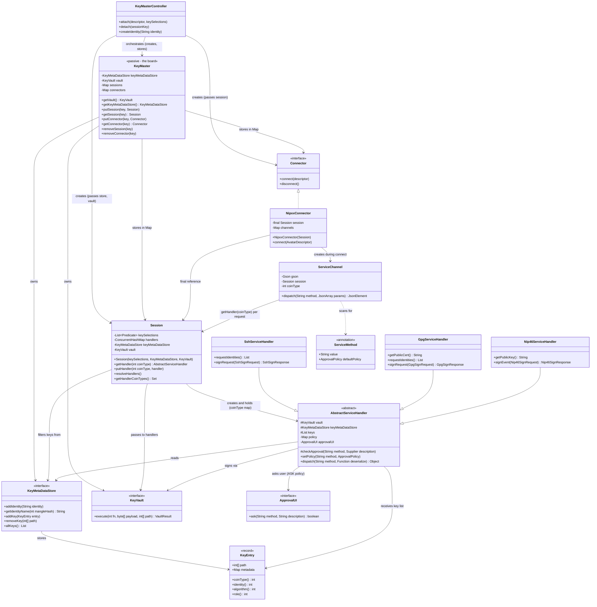
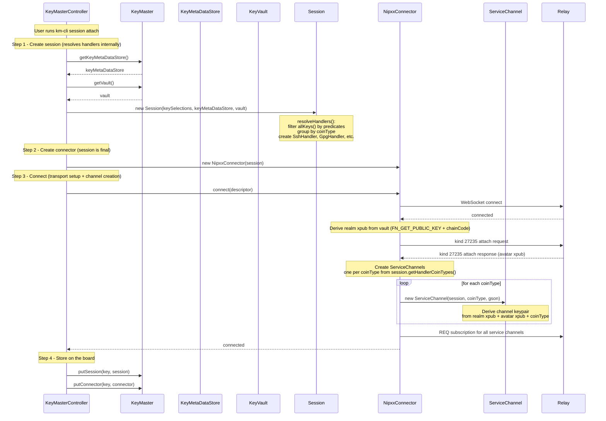
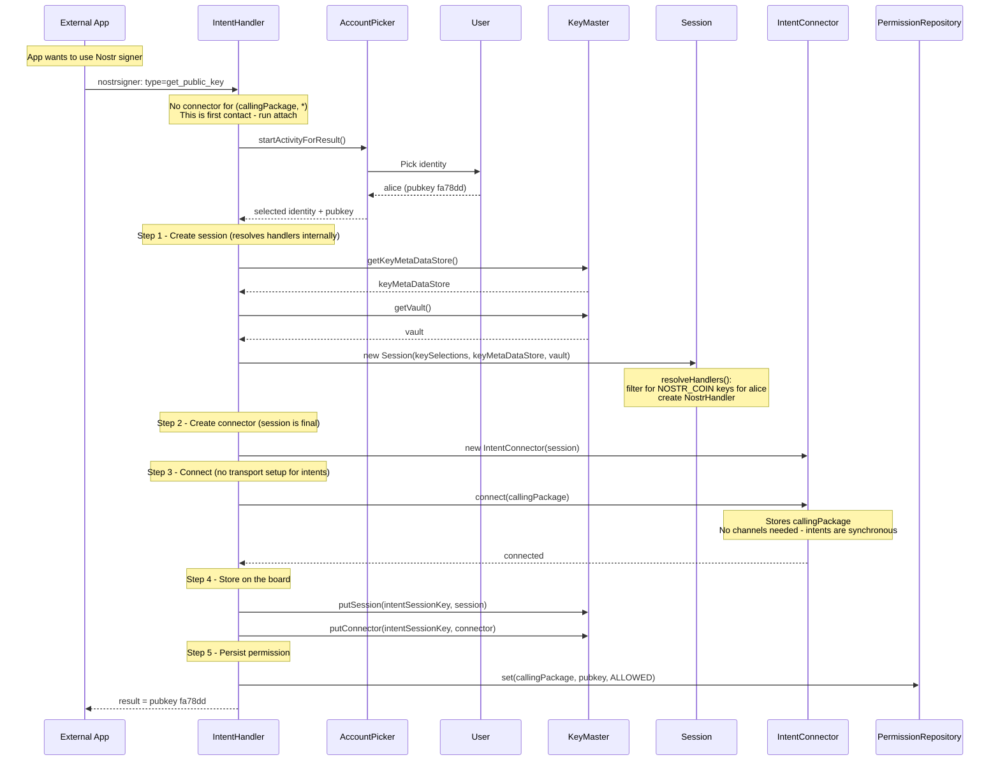
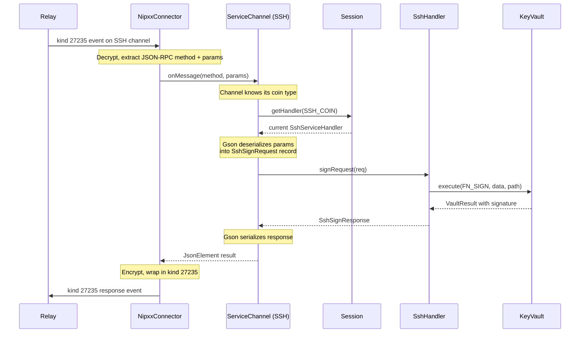

# Service Handler Design

## Problem

The current `KeyMaster` class has hardcoded SSH and GPG request handling
with JSON-RPC parameters baked into the method signatures. This creates
two problems:

1. **Protocol coupling** — adding a new protocol (e.g. NIP-46) means editing
   `KeyMaster` directly.
2. **Wire format coupling** — the handlers take `JsonArray` params, which
   forces non-JSON connectors (Android intents, future gRPC, etc.) to
   manufacture JSON objects just to call the handler.

## Overview



### Attach sequence — NipxxConnector (desktop)



### Attach sequence — IntentConnector (Android)



### Request dispatch sequence



## Design

### Typed service handlers

Each protocol gets its own handler class with typed Java methods. No JSON,
no Bundle, no wire format anywhere in the handler.

```java
class SshServiceHandler extends AbstractServiceHandler {

    @ServiceMethod(value = "request_identities", defaultPolicy = APPROVE)
    List<SshIdentity> requestIdentities() {
        checkApproval("request_identities", null);
        return keys.stream().map(...).toList();
    }

    @ServiceMethod(value = "sign_request", defaultPolicy = ASK)
    SshSignResponse signRequest(SshSignRequest req) {
        checkApproval("sign_request", () ->
            "Sign with key " + fingerprint(req.keyBlob())
            + ", " + req.data().length + " bytes");
        // approved — do the work
        ...
    }
}

class GpgServiceHandler extends AbstractServiceHandler {

    @ServiceMethod(value = "get_public_cert", defaultPolicy = APPROVE)
    String getPublicCert() {
        checkApproval("get_public_cert", null);
        ...
    }

    @ServiceMethod(value = "request_identities", defaultPolicy = APPROVE)
    List<GpgIdentity> requestIdentities() {
        checkApproval("request_identities", null);
        ...
    }

    @ServiceMethod(value = "sign_request", defaultPolicy = ASK)
    GpgSignResponse signRequest(GpgSignRequest req) {
        checkApproval("sign_request", () ->
            "GPG sign with key " + keyId(req.publicKey()));
        ...
    }
}

class Nip46ServiceHandler extends AbstractServiceHandler {

    @ServiceMethod(value = "get_public_key", defaultPolicy = APPROVE)
    String getPublicKey() {
        checkApproval("get_public_key", null);
        ...
    }

    @ServiceMethod(value = "sign_event", defaultPolicy = ASK)
    Nip46SignResponse signEvent(Nip46SignRequest req) {
        checkApproval("sign_event", () ->
            "Sign Nostr event: " + summarize(req.eventJson()));
        ...
    }
}
```

### Request/response records

Each method's parameters and return values are plain Java records. These
records are the contract between connectors and handlers.

```java
// SSH
record SshSignRequest(byte[] keyBlob, byte[] data) {}
record SshSignResponse(byte[] signature, String keyType) {}
record SshIdentity(byte[] keyBlob, String comment) {}

// GPG
record GpgSignRequest(byte[] publicKey, byte[] data) {}
record GpgSignResponse(byte[] signature) {}
record GpgIdentity(String keyType, byte[] publicKey, String label) {}

// NIP-46
record Nip46SignRequest(String eventJson) {}
record Nip46SignResponse(String signedEventJson) {}
```

Field naming convention: Java camelCase in the record, mapped to
`snake_case` on the wire by the serializer (e.g. Gson's
`LOWER_CASE_WITH_UNDERSCORES` naming policy). `byte[]` fields are
serialized as base64 strings in JSON.

### Abstract base class

All handlers share a common base that holds the vault and the key entries
assigned to this handler. The handler does not derive keys or construct
paths — it receives pre-resolved `KeyEntry` records from the key database.

```java
abstract class AbstractServiceHandler {
    protected final KeyVault vault;
    protected final KeyMetaDataStore keyMetaDataStore;
    protected final List<KeyEntry> keys;
    private final Map<String, ApprovalPolicy> policy;
    private final ApprovalUI approvalUI;              // nullable

    AbstractServiceHandler(KeyVault vault, KeyMetaDataStore keyMetaDataStore,
                           List<KeyEntry> keys, ApprovalUI approvalUI) {
        this.vault = vault;
        this.keyMetaDataStore = keyMetaDataStore;
        this.keys = keys;
        this.approvalUI = approvalUI;
        this.policy = buildDefaultPolicy();  // scan @ServiceMethod annotations
    }

    /** Policy gate — called by each handler method. */
    protected void checkApproval(String method, Supplier<String> description) {
        ApprovalPolicy p = policy.getOrDefault(method, ASK);
        if (p == DENY)  throw new RequestDeniedException(method);
        if (p == ASK) {
            if (approvalUI == null || !approvalUI.ask(method, description.get())) {
                throw new RequestDeniedException(method);
            }
        }
        // APPROVE — fall through
    }

    /** Override policy for a method (controller can tighten/loosen). */
    void setPolicy(String method, ApprovalPolicy p) {
        policy.put(method, p);
    }

    private Map<String, ApprovalPolicy> buildDefaultPolicy() {
        Map<String, ApprovalPolicy> map = new HashMap<>();
        for (Method m : getClass().getMethods()) {
            ServiceMethod ann = m.getAnnotation(ServiceMethod.class);
            if (ann != null) map.put(ann.value(), ann.defaultPolicy());
        }
        return map;
    }
}
```

Key selection (which key to sign with) is protocol-specific logic that
lives entirely in the handler subclass:

- **SSH**: Caller sends `key_blob` (SSH wire format) — handler parses it,
  matches against its key list.
- **GPG**: Caller sends `public_key` (raw bytes) — handler matches against
  its key list by comparing pubkeys.
- **NIP-46**: No key selection — there is exactly one key.
- **Future X.509/S/MIME**: Could match by certificate subject, key usage, etc.

There is no generic `sign(pubkey, data)` on the base class. Each handler
does its own key resolution and calls `vault.execute(FN_SIGN, data, path)`
directly.

### The @ServiceMethod annotation

A single annotation marks which methods are callable, what wire method
name they map to, and their default approval policy.

```java
@Retention(RetentionPolicy.RUNTIME)
@Target(ElementType.METHOD)
@interface ServiceMethod {
    String value();                              // wire method name
    ApprovalPolicy defaultPolicy() default ASK;  // APPROVE, DENY, or ASK
}

enum ApprovalPolicy { APPROVE, DENY, ASK }
```

### Generic dispatch via ServiceChannel

`ServiceChannel` is a standalone class — not an inner class of any connector.
It receives all dependencies via constructor: the session (for handler
lookup), the coin type it serves, and a Gson instance for serialization.

On each request the channel looks up the current handler from the session,
deserializes the params into the method's record type, calls the method,
and serializes the result.

```java
class ServiceChannel {
    private final Session session;
    private final int coinType;
    private final Gson gson;

    ServiceChannel(Session session, int coinType, Gson gson) {
        this.session = session;
        this.coinType = coinType;
        this.gson = gson;
    }

    /** Dispatch a JSON-RPC method call. */
    JsonElement dispatch(String method, JsonArray params) {
        AbstractServiceHandler handler = session.getHandler(coinType);
        if (handler == null) {
            throw new IllegalStateException("no handler for coin type: " + coinType);
        }
        MethodBinding binding = resolveMethod(handler, method);
        return binding.invoke(gson, params);
    }

    private MethodBinding resolveMethod(Object handler, String method) {
        for (Method m : handler.getClass().getMethods()) {
            ServiceMethod ann = m.getAnnotation(ServiceMethod.class);
            if (ann != null && ann.value().equals(method)) {
                Class<?> reqType = m.getParameterCount() > 0
                    ? m.getParameterTypes()[0] : null;
                return new MethodBinding(m, handler, reqType);
            }
        }
        throw new IllegalArgumentException("unknown method: " + method);
    }

    private record MethodBinding(Method method, Object handler, Class<?> reqType) {
        JsonElement invoke(Gson gson, JsonArray params) {
            try {
                Object arg = reqType != null
                    ? gson.fromJson(params.get(0), reqType) : null;
                Object result = reqType != null
                    ? method.invoke(handler, arg) : method.invoke(handler);
                return gson.toJsonTree(result);
            } catch (InvocationTargetException e) {
                throw new RuntimeException(e.getCause());
            } catch (IllegalAccessException e) {
                throw new RuntimeException(e);
            }
        }
    }
}
```

### Gson setup

A single Gson instance handles all serialization. Configured once:

```java
Gson gson = new GsonBuilder()
    .registerTypeAdapter(byte[].class, new Base64TypeAdapter())
    .setFieldNamingPolicy(FieldNamingPolicy.LOWER_CASE_WITH_UNDERSCORES)
    .create();
```

The `Base64TypeAdapter` handles `byte[]` ↔ base64 string conversion:

```java
class Base64TypeAdapter extends TypeAdapter<byte[]> {
    @Override
    public void write(JsonWriter out, byte[] value) throws IOException {
        out.value(Base64.getEncoder().encodeToString(value));
    }

    @Override
    public byte[] read(JsonReader in) throws IOException {
        return Base64.getDecoder().decode(in.nextString());
    }
}
```

This means:
- Java `byte[] keyBlob` ↔ JSON `"key_blob": "AAAA..."` (base64)
- Java `String comment` ↔ JSON `"comment": "alice@atlanta.com"`
- Java `SshSignRequest` record ↔ JSON `{"key_blob": "...", "data": "..."}`

No manual field extraction anywhere.

## Key database

### Problem

The KeyVault can derive a key at any BIP-32 path — the tree is effectively
infinite. But a key only "exists" if the user explicitly created it. Today
the code hardcodes the key topology: one SSH Ed25519 key per identity, two
GPG Ed25519 keys (cert + sign roles), one Nostr Schnorr key. Adding a second
SSH key, a different algorithm, or a new protocol means editing handler code.

The key database is the registry of "keys that actually exist."

### Path as database key

Every key in the system is identified by its BIP-32 derivation path: 5
levels, each a 32-bit int (31 bits value + 1 bit hardened flag). Total:
20 bytes.

```
path[0]: purpose       — 44 | H                                    (fixed)
path[1]: coin_type     — Protocol enum (1237–1241) | H              (protocol)
path[2]: identity      — mangle(identity_string) | H               (identity)
path[3]: algorithm     — alg(15b) | variant(8b) | role(8b) | H     (key type)
path[4]: config        — csprng(7b) | index(24b) | H               (derivation config)
```

The path encodes protocol, identity, algorithm, and role. These can be
extracted from the path by code — `Protocol` enum resolves `path[1]`,
`AlgField` decodes `path[3]`, etc. No redundant fields needed.

The one irreversible component is `path[2]`: `mangle()` is a SHA-256 hash
truncated to 31 bits. You cannot recover `"alice@atlanta.com"` from
`0x1C3F...`. The original identity string must be stored separately.

### Data model

Two data structures:

**Identity name map** — reverse lookup for the mangle hash:

```java
Map<Integer, String> identityNames;  // mangle hash → original string
// e.g. 1847302 → "alice@atlanta.com"
```

Populated when the user creates an identity. Shared across all keys.
One entry per identity, not per key.

**Key entries** — keyed by derivation path:

```java
record KeyEntry(
    HDPath path,                   // 5-level BIP-32 path (bitcoinj)
    Map<String, String> metadata   // optional, protocol-specific
)
```

The path is a bitcoinj `HDPath` — immutable, with proper `equals()`/`hashCode()`
based on value semantics. The KeyVault API accepts raw `int[]`; conversion
happens at the KV API boundary. `HDPath` is a convenience wrapper above that
boundary.

Public keys are not stored — they are derived from the vault on demand
via `vault.execute(FN_GET_PUBLIC_KEY, null, path)`. Given the same seed
and path, the result is always the same. Handlers that need the pubkey
derive it at construction time.

Metadata is opaque to the database. The GPG handler stores
`{"created_at": "1970-01-01T00:00:01Z"}` because OpenPGP certs need a
fixed timestamp for deterministic fingerprints. The SSH handler stores
nothing. The database doesn't interpret metadata — it stores and returns it.

Convenience accessors read directly from the path via `ChildNumber.num()`
(which strips the hardened bit internally):

```java
int coinType()  { return path.get(1).num(); }
int identity()  { return path.get(2).num(); }
int algorithm() { return (path.get(3).num() >> 16) & 0x7FFF; }
int variant()   { return (path.get(3).num() >> 8) & 0xFF; }
int role()      { return path.get(3).num() & 0xFF; }
```

### Persistence

Two files, both write-through (write to disk on every mutation, serve
from memory):

**`$KM_HOME/identity-names.json`** — mangle reverse map:

```json
{
  "1847302": "alice@atlanta.com",
  "982741": "bob@boston.org"
}
```

**`$KM_HOME/key-metadata.json`** — flat list of key entries:

```json
[
  {
    "path": "m/44'/1238'/624718342'/65536'/0'",
    "metadata": {}
  },
  {
    "path": "m/44'/1239'/624718342'/65536'/0'",
    "metadata": {"created_at": "1970-01-01T00:00:01Z"}
  }
]
```

Paths are serialized as standard BIP-32 strings with apostrophe notation
for hardened levels. `1238` = SSH, `1239` = OpenPGP. Human-readable in
domain terms without hex-to-int conversion.

The in-memory model is a `Map<HDPath, KeyEntry>` keyed by the derivation
path, plus the identity name map. Both loaded at startup.

### Store interface

```java
interface KeyMetaDataStore {
    void addIdentity(String identity);          // stores mangle → name
    String getIdentityName(int mangleHash);     // reverse lookup

    void addKey(KeyEntry entry);                // persists immediately
    void removeKey(HDPath path);                // by exact path
    KeyEntry getKey(HDPath path);               // exact lookup
    List<KeyEntry> keysByProtocol(int coinType); // all keys for a protocol
    List<KeyEntry> keysByIdentity(int mangleHash); // all keys for an identity
    List<KeyEntry> allKeys();
}
```

Platform-specific implementations: `FileKeyMetaDataStore` for desktop (JSON files),
`AndroidKeyMetaDataStore` for Android (SharedPreferences or SQLite). The interface
is in `keymaster.core`, implementations in platform modules.

### Key lifecycle

1. **User creates identity** via KM Ctrl API:
   `km-cli identity create alice@atlanta.com`

2. **Controller stores identity name**: `keyStore.addIdentity("alice@atlanta.com")`
   — records the mangle hash → name mapping.

3. **Controller applies key template** — a default set of keys for the identity.
   Initially hardcoded, future: user-configurable.

   ```
   Default template:
     ssh/ed25519        → PURPOSE / SSH_COIN / mangle(id) / ALG_ED25519 / CONFIG
     gpg/ed25519/cert   → PURPOSE / OPENPGP_COIN / mangle(id) / ED25519_role0 / CONFIG
     gpg/ed25519/sign   → PURPOSE / OPENPGP_COIN / mangle(id) / ED25519_role1 / CONFIG
     nostr/schnorr      → PURPOSE / NOSTR_COIN / mangle(id) / ALG_SCHNORR / CONFIG
   ```

4. **For each template entry**: controller constructs the path,
   creates a `KeyEntry(path, metadata)`, and calls `keyStore.addKey(entry)`.

5. **Key now exists** in the database and can be served by handlers.

Key creation is a controller concern (KeyMasterController / IntentHandler).
The key store and vault are accessed through KeyMaster (the board).

### Session and key selection

A session is an active attachment to an avatar. It holds a key filter —
a `Predicate<KeyEntry>` that selects which keys from the database this
session should serve.

`Predicate<T>` is a standard Java functional interface (`java.util.function`)
— a function that takes a `T` and returns `boolean`. Predicates compose
with `.and()`, `.or()`, `.negate()`.

```java
class Session {
    private final List<Predicate<KeyEntry>> keySelections;
    private final KeyMetaDataStore keyMetaDataStore;
    private final KeyVault vault;
    private final ConcurrentHashMap<Integer, AbstractServiceHandler> handlers;

    Session(List<Predicate<KeyEntry>> keySelections,
            KeyMetaDataStore keyMetaDataStore, KeyVault vault) {
        this.keySelections = keySelections;
        this.keyMetaDataStore = keyMetaDataStore;
        this.vault = vault;
        this.handlers = new ConcurrentHashMap<>();
        resolveHandlers();
    }
}
```

The session takes a list of predicates, the key store, and the vault at
creation time. It resolves handlers internally — the controller does not
construct handlers. Each predicate is a selection — "include keys matching
this." The session combines them with OR: a key is included if **any**
selection matches.

```java
Predicate<KeyEntry> combined = keySelections.stream()
    .reduce(k -> false, Predicate::or);
```

AND logic lives *inside* an individual predicate when needed (e.g.
"alice AND ssh"). The list itself is always a union of selections.

How the predicates are constructed is a UI/ctrl concern — KeyMaster
does not care. The ctrl layer can build them from CLI args, UI checkboxes,
a saved profile, or anything else. Initially the CLI will likely build
one predicate per `--identity` flag; finer-grained filtering (by protocol,
algorithm, role) is supported by the architecture but left for later UI
work.

The filter operates on `KeyEntry` convenience accessors. Each accessor
reads a fixed path position and strips the hardened bit:

```java
// coin type
k -> k.coinType() == Protocol.SSH.coinType()

// identity
k -> k.identity() == Bip32KeyDerivator.mangle("alice@atlanta.com")

// algorithm
k -> k.algorithm() == AlgField.ALG_ED25519
```

**Examples:**

```java
// All keys for alice (default when user specifies just an identity)
k -> k.identity() == mangle("alice@atlanta.com")

// Alice's SSH keys + Bob's SSH keys
k -> k.coinType() == SSH_COIN
     && (k.identity() == mangle("alice")
         || k.identity() == mangle("bob"))

// Only alice's SSH RSA key, not her ed25519
k -> k.identity() == mangle("alice")
     && k.coinType() == SSH_COIN
     && k.algorithm() == ALG_RSA

// Everything in the database
k -> true
```

The session resolves the filter against the key store internally via
`resolveHandlers()`: filters `allKeys()` by the combined predicate,
groups by coin type, and constructs a handler per protocol. The handler
receives exactly the keys it should serve. No database access, no path
construction, no derivation from the handler's perspective.

### Runtime key changes

The ServiceChannel does not cache handlers — on every incoming request,
it looks up the current handler from the session:

```
Request arrives at NipxxConnector (coin type = SSH)
  → ServiceChannel.dispatch("sign_request", params)
  → session.getHandler(SSH_COIN)
  → returns current SshServiceHandler
  → dispatches to it
```

When a key is added or removed while a session is active, the session
can re-resolve its handlers. The next request automatically picks up
the new handler:

```
Key store mutation (addKey / removeKey)
  → session.resolveHandlers()
  → re-applies predicate filter, rebuilds affected handlers
  → ConcurrentHashMap updated
  → next request gets the new handler
```

No push notification to the connector, no re-registration, no gap.
The `ConcurrentHashMap` in the session ensures thread safety.

Handlers remain immutable — constructed once with a fixed key list, then
discarded and replaced when the key set changes.

### Wiring at attach time

The controller does all orchestration. KeyMaster is passive — it provides
access to its owned objects (vault, key store) and stores the resulting
session and connector in its maps.

```java
// KeyMasterController.attach(descriptor, keySelections):
KeyVault vault = keyMaster.getVault();
KeyMetaDataStore store = keyMaster.getKeyMetaDataStore();

// 1. Create session — resolves handlers internally
Session session = new Session(keySelections, store, vault);

// 2. Create connector — session is final
NipxxConnector connector = new NipxxConnector(session);

// 3. Connect — transport setup + channel creation
connector.connect(descriptor);
// Inside connect():
//   - WebSocket to relay
//   - Attach handshake (realm keypair, avatar xpub exchange)
//   - For each coinType in session.getHandlerCoinTypes():
//       new ServiceChannel(session, coinType, gson)
//       derive channel keypair from realm + avatar xpubs
//   - Subscribe to all channel events on relay

// 4. Store on the board
keyMaster.putSession(key, session);
keyMaster.putConnector(key, connector);
```

When an event arrives on the SSH service channel:

```
Relay event → decrypt → route to SSH ServiceChannel
  → serviceChannel.dispatch("sign_request", params)
    → session.getHandler(SSH_COIN)           — live lookup, always current
    → Gson deserializes params into SshSignRequest record
    → sshHandler.signRequest(req) — typed Java, no JSON
    → Gson serializes SshSignResponse to JSON
  → encrypt → send response event
```

### Adding a new protocol

To add a new protocol (e.g. NIP-46):

1. Define the request/response records in `keymaster.core`
2. Write the handler class extending `AbstractServiceHandler`
3. Annotate methods with `@ServiceMethod`
4. Add the coin type to the handler factory in Session's `resolveHandlers()`

No changes to the dispatch infrastructure, the connector, or any existing
handler. The ServiceChannel resolves `@ServiceMethod` annotations
dynamically from whatever handler the session returns.

### Adding a new connector

To add a new connector (e.g. Android intents):

1. The connector implements its own wire format translation
2. It can reuse `ServiceChannel` if it speaks JSON internally
3. Or it can build an equivalent `BundleChannel` that uses the same
   `@ServiceMethod` annotations but deserializes from `Bundle` instead
   of JSON

The handler classes are shared across all connectors — they contain only
vault operations and typed Java.

## Approval handling

Approval is handled entirely inside the handler. Each `@ServiceMethod`
annotated method calls `checkApproval()` as its first action. The base
class (`AbstractServiceHandler`) provides the policy gate; the handler
method provides the method-specific rendering for the ASK case.

### Policy model

```java
enum ApprovalPolicy { APPROVE, DENY, ASK }
```

Each handler holds a `Map<String, ApprovalPolicy>` populated at
construction from the `@ServiceMethod(defaultPolicy = ...)` annotation
defaults. The controller can override individual entries via
`setPolicy()` to tighten or loosen based on trust context (e.g.
IntentHandler may set everything to ASK for unknown callers).

### Approval flow

```
handler method called
  → checkApproval(method, description)
    → policy.get(method)
      → APPROVE → proceed (fall through)
      → DENY   → throw RequestDeniedException
      → ASK    → approvalUI.ask(method, description)
        → user approves → proceed
        → user denies   → throw RequestDeniedException
```

### ApprovalUI interface

```java
interface ApprovalUI {
    boolean ask(String method, String description);
}
```

Platform-specific: Android shows an `ApprovalActivity`, desktop could
show a terminal prompt or GUI dialog. Passed to the handler at
construction time (via Session). Nullable — if no UI is available,
ASK is treated as DENY.

### Why approval lives in the handler method

- Each method knows its own data and how to describe it to the user
  ("Sign with key X, N bytes" vs "GPG sign with key ID Y")
- The policy map uses `(handler instance, method name)` as the
  effective key — `sign_request` on SSH is independent from
  `sign_request` on GPG
- No generic rendering — each method provides its own `Supplier<String>`
  description for the ASK case
- Future enhancement: the `@ServiceMethod` annotation could carry a
  renderer class for automated settings UI discovery

## Android intent handling

### Two controllers

The system has two controller entry points:

- **KeyMasterController** (desktop) — receives CLI commands, creates
  sessions and NipxxConnectors, wires them, stores on KeyMaster.
  One session per avatar.
- **IntentHandler** (Android) — receives Android intents from external
  apps, creates sessions and IntentConnectors, wires them, stores on
  KeyMaster. One session per `(callingPackage, pubkey)` pair.

Both are controllers. Neither is a connector. They orchestrate the
creation, wiring, and storage of sessions and connectors on KeyMaster
(the board).

### Intent routing

The IntentHandler looks up active connectors from KeyMaster's maps:

```java
record IntentSessionKey(String callingPackage, String pubkey) {}
// Stored in KeyMaster's connector map, keyed by IntentSessionKey
```

When an intent arrives:

```
intent arrives (callingPackage, type, current_user, data)
  → keyMaster.getConnector(callingPackage, current_user) exists?
    → YES: route to connector → dispatch to handler
    → NO:  check PermissionRepository
      → ALLOWED: recreate connector + session, store on keyMaster (lazy recovery)
      → null:    unknown caller — run attach flow
```

### Attach flow for intents

An unknown request triggers an attach, just like `km-cli session attach`
does on the desktop. The trigger depends on the protocol standard:

**NIP-55 (Nostr):** The trigger is `get_public_key`.

```
External app sends: nostrsigner: with type = "get_public_key"
  → IntentHandler: no connector in keyMaster for (callingPackage, *)
  → Launch AccountPickerActivity
  → User selects identity (e.g. alice, pubkey "fa78dd...")
  → IntentHandler creates session + connector, wires them,
    stores on keyMaster under ("com.amethyst", "fa78dd...")
  → Store permission: PermissionRepository.set(callingPackage, pubkey, ALLOWED)
  → Return pubkey to calling app
```

**Future protocol (e.g. Bitcoin):** A different trigger and different
key selection, but the same pattern — unknown request → controller
creates session + connector → wires → stores on the board.

### Subsequent requests

Once attached, the calling app includes `current_user` (the pubkey from
the attach step) in every request. The IntentHandler routes by
`(callingPackage, current_user)`:

```
External app sends: nostrsigner:{eventJson}
  type = "sign_event", current_user = "fa78dd..."
  → IntentHandler: keyMaster.getConnector("com.amethyst", "fa78dd...")
  → connector dispatches to handler via session
  → handler.signEvent(request)
  → setResult() back to calling app
```

### Multiple apps, same pubkey

Two apps can connect to the same pubkey independently. Each gets its own
connector and session, stored in KeyMaster's maps. The
`(callingPackage, pubkey)` pair is the map key:

```
keyMaster.connectors:
  ("com.amethyst", "fa78dd...") → connector A
  ("com.primal",   "fa78dd...") → connector B

keyMaster.sessions:
  ("com.amethyst", "fa78dd...") → session A
  ("com.primal",   "fa78dd...") → session B
```

The `callingPackage` is provided by Android OS and cannot be faked by the
calling app. This prevents unauthorized apps from accessing keys by
guessing pubkeys.

### Multiple pubkeys, same app

One app can call `get_public_key` multiple times (e.g. multi-account).
Each granted pubkey gets its own entry in KeyMaster's maps:

```
("com.amethyst", "fa78dd...") → connector/session for alice
("com.amethyst", "3b91cc...") → connector/session for bob
```

The app uses `current_user` to select which account on each request.

### Persistence and lazy recovery

Permissions are persisted (PermissionRepository uses EncryptedSharedPreferences).
Sessions and connectors in KeyMaster's maps are in-memory and lost on app
restart. When a request arrives for a known permission but no in-memory
connector, the IntentHandler recreates the session and connector, wires
them, and stores them on KeyMaster. This makes the system resilient to
process restarts.

### Content Provider path

NIP-55 also defines a ContentProvider for background operations (no UI).
Same routing logic, same permission check, but accessed via
`contentResolver.query()` instead of an intent. The IntentHandler
handles both paths.

### Connector comparison

The attach sequences for both connectors are shown in the
[NipxxConnector attach](#attach-sequence--nipxxconnector-desktop) and
[IntentConnector attach](#attach-sequence--intentconnector-android)
diagrams above.

| Aspect | KeyMasterController + NipxxConnector | IntentHandler + IntentConnector |
|--------|-------------------------------------|-------------------------------|
| Trigger | User runs `km-cli session attach` | External app sends intent |
| Attach | Explicit, user-initiated | `get_public_key` (or protocol equivalent) |
| Map key | Avatar descriptor | (callingPackage, pubkey) pair |
| Key selection | User-specified predicates | Protocol-specific (NIP-55 = Nostr keys) |
| Transport | Nostr relay, NIP-44 encrypted | Android intent / ContentProvider |
| Persistence | Ephemeral (lost on restart) | Permissions persisted, sessions/connectors recreated lazily |
| Multiplicity | One avatar at a time | Many external apps simultaneously |

## Layer summary

**Architectural rule:** No inner classes. All classes are standalone and
receive dependencies via constructor parameters.

**KeyMaster is passive** — it is the board, not a player. It owns the
vault, key store, and maps of sessions/connectors. Controllers are the
active components that create, wire, and store objects on the board.

| Layer | Lives in | Role | Knows about | Doesn't know about |
|-------|----------|------|-------------|-------------------|
| KeyMaster | `keymaster.core` | The board — holds vault, key store, session/connector maps | Everything it stores | How things are created or wired |
| KeyMasterController | `keymaster.desktop` | Active player — orchestrates attach/detach | CLI args, NipxxConnector, KeyMaster | Intents, Android |
| IntentHandler | `keymaster.android` | Active player — orchestrates attach/detach | Intents, callingPackage, PermissionRepository, KeyMaster | Relay, NIP-44 |
| Session | `keymaster.core` | Handler map, key filter | Handlers, key selections | Connectors, transport, how filter was built |
| KeyMetaDataStore | `keymaster.core` (interface) | Key registry | Paths, identity names, metadata | Vault, protocols, handlers |
| KeyEntry | `keymaster.core` | Data record | Path, metadata | Pubkeys (derived from vault on demand) |
| ServiceHandler | `keymaster.core` | Protocol logic | Vault, its key list, typed records | JSON, intents, channels, relay, key DB, session |
| ServiceChannel | `keymaster.core` | Dispatch layer | Session, coinType, Gson, @ServiceMethod | Transport, vault internals |
| Connector | `keymaster.connector.*` | Transport | Session (via connect), encrypt/decrypt, relay/intents | Handler logic, key derivation |
| Records | `keymaster.core` | Data contract | Field names and types | Serialization format |
| Gson + TypeAdapters | `keymaster.connector.*` | Serialization | byte[] ↔ base64, camelCase ↔ snake_case | Business logic |

## Design evolution

This design was reached through iterative simplification:

1. **Hardcoded switch** in KeyMaster — fragile, coupled
2. **Method map with hand-written lambdas** — boilerplate, error-prone
   field extraction
3. **Records + Gson** — eliminated parsing boilerplate, single source
   of truth for field mapping
4. **Generic dispatch** — eliminated serialization boilerplate, uniform
   "record in, record out" pattern
5. **@ServiceMethod annotations** — eliminated registration boilerplate,
   auto-discovery via reflection

Each step removed one layer of manual work. The annotation "framework" is
one annotation class + one for loop — not a framework at all.
