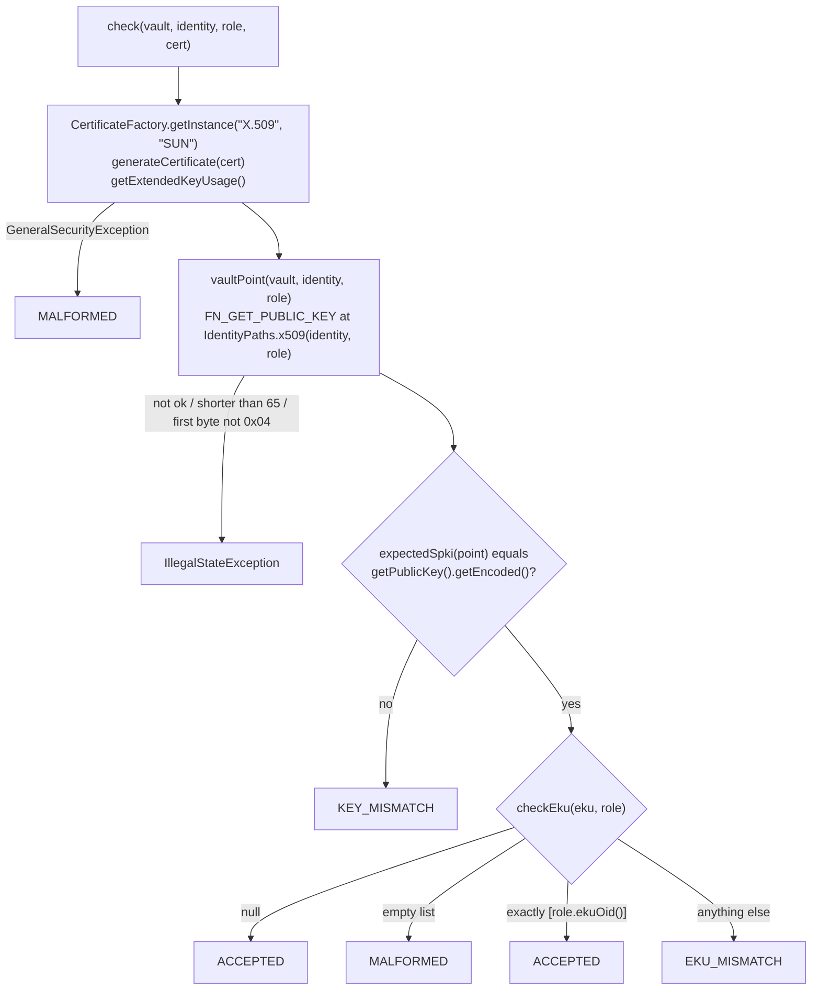
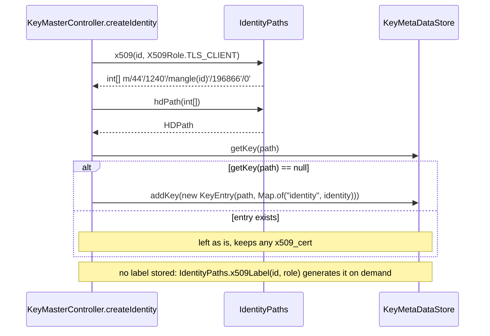

# X.509 Keys in KeyMaster Core

Status: As built — mission 37.1.2

KeyMaster derives X.509 keys (P-256) from the same seed and identity as its
SSH, OpenPGP and Nostr keys. This step adds the paths, the generated labels,
a JDK-only check that a certificate carries the vault's key, and a metadata
slot for the certificate. Nothing fills the slot yet (37.1.5) and nothing
serves these keys yet (37.1.3).

"Certificate" in this document means an X.509 certificate. OpenPGP
certificates (`GpgPublicCert`, `OpenPgpCertBuilder`) are unrelated.

## Code Map

All classes are in `club.dwdc.keymaster.core`, package `club.dwdc.keymaster`.

| Code | Responsibility |
|---|---|
| `X509Role` | The one role table: path role byte, label token, EKU OID |
| `IdentityPaths.x509(Identity, X509Role)` | The frozen derivation path of an X.509 key |
| `IdentityPaths.x509Label(Identity, X509Role)` | The generated label `"<identity> <token>"` |
| `X509CertCheck` | Checks a certificate against the vault key at the path; never builds one |
| `X509CertSlot` | Reads and writes the `x509_cert` metadata key of a `KeyEntry` |
| `KeyMasterController.createIdentity` | Registers the TLS client entry in the desktop `KeyMetaDataStore` |
| `src/test/resources/x509/make-fixtures.sh` | Makes the test certificates with openssl (run by hand) |

No main code calls `x509Label`, `X509CertCheck` or `X509CertSlot` yet; their
callers arrive in 37.1.3 and 37.1.5.

## Roles

From `X509Role`. The number is the role byte of the path's `AlgField` and is
frozen. The token is part of every label of that role, so it is frozen too.
Tokens use only RFC 3986 unreserved characters.

| Constant | Number | Token | EKU OID |
|---|---|---|---|
| `CA` | 0 | `ca` | none |
| `TLS_SERVER` | 1 | `tls-server` | `1.3.6.1.5.5.7.3.1` (serverAuth) |
| `TLS_CLIENT` | 2 | `tls-client` | `1.3.6.1.5.5.7.3.2` (clientAuth) |
| `CODE_SIGNING` | 3 | `code-signing` | `1.3.6.1.5.5.7.3.3` (codeSigning) |
| `SMIME` | 4 | `smime` | `1.3.6.1.5.5.7.3.4` (emailProtection) |

`createIdentity` registers `TLS_CLIENT` only.

## Certificate Check

`X509CertCheck.check(KeyVault, Identity, X509Role, byte[])` returns a
`Verdict`:



The EKU list is read in the same `try` block as parsing, so a malformed EKU
extension also yields `MALFORMED`. The key comparison runs before the EKU
rule is applied.

The parser is the JDK's `SUN` provider, named explicitly.
`NostrServiceHandler` and `NostrTransport` insert BouncyCastle at provider
position 1, and an unnamed `getInstance("X.509")` would hand parsing to it.
No bcpkix is used; it is not in the dependency tree.

### Not Checked

The check does not look at the chain or issuer, validity dates, revocation,
subject, or SAN. An expired certificate, or one from an unknown CA, is
accepted if key and EKU match.

### Exact-DER Strictness

The certificate's SubjectPublicKeyInfo must equal the expected SPKI byte for
byte: named curve prime256v1, uncompressed point. A certificate that carries
the right key as a compressed point, or with explicit curve parameters, is
rejected with `KEY_MISMATCH`. This is intended.

A certificate for a CA is accepted only without an EKU: `CA` has no OID, so
any EKU yields `EKU_MISMATCH`.

## Identity Creation

The X.509 part of `createIdentity`. It runs only in the desktop branch
(`km.keyMetaDataStore != null`), after the SSH, OpenPGP, Nostr and MLS
entries are added.



No vault call is made for the X.509 key; the path is a pure function of
identity and role. The Android branch (`km.kvMetaStore`) registers no X.509
entry.

## Data Formats

Path of Alice's TLS client key:

```text
m/44'/1240'/1955269225'/196866'/0'

1240        Protocol.X509
1955269225  mangle("alice@atlanta.com")
196866      AlgField(ALG_ECDSA = 3, variant P-256 = 1, TLS_CLIENT = 2)
            = 3 << 16 | 1 << 8 | 2
0           ConfigField(CSPRNG_NONE, 0)
```

All levels are hardened. The level-5 index is always 0.

Label, generated and never stored:

```text
alice@atlanta.com tls-client
```

In a PKCS#11 URI (RFC 7512) the label is the `object` attribute. The space
must be encoded as `%20`; `@` may appear literally or as `%40`:

```text
pkcs11:object=alice@atlanta.com%20tls-client
pkcs11:object=alice%40atlanta.com%20tls-client
```

No main code builds PKCS#11 URIs yet; the encoding is covered by a test.
`doc/PKCS11.md` uses the same label on the certificate, public-key and
private-key-reference objects.

Expected SubjectPublicKeyInfo, 91 bytes: a fixed 26-byte P-256 prefix
followed by the vault's 65-byte SEC1 uncompressed point (`04 || X || Y`, the
`data()` of `FN_GET_PUBLIC_KEY`):

```text
3059301306072a8648ce3d020106082a8648ce3d030107034200 || point
```

Certificate slot: metadata key `x509_cert` (`X509CertSlot.KEY`), value the
certificate's DER, base64. In `$KM_HOME/key-metadata.json`:

```json
{
  "path": "m/44'/1240'/1955269225'/196866'/0'",
  "metadata": {
    "identity": "alice@atlanta.com",
    "x509_cert": "MIIB..."
  }
}
```

The example value is shortened. `createIdentity` writes only `identity`; no
code writes `x509_cert` yet.

## Error Cases

| Result | When |
|---|---|
| `ACCEPTED` | SPKI matches and EKU is absent or exactly the role's OID |
| `MALFORMED` | The SUN parser rejects the certificate or its EKU, or the EKU list is empty |
| `KEY_MISMATCH` | The certificate's SPKI differs from the vault key's |
| `EKU_MISMATCH` | Any other EKU: another usage, an extra usage, anyExtendedKeyUsage (`2.5.29.37.0`), or any EKU on a CA |
| `IllegalStateException` | The vault returns no 65-byte uncompressed point for the path |

## Tests

Core, unless noted:

- `IdentityPathsTest.x509TlsClientMatchesTheMission`: the literal path above.
- `IdentityPathsTest.x509LabelIsGenerated`: `"alice@atlanta.com tls-client"`.
- `IdentityPathsTest.x509LabelSurvivesPercentEncoding`: `%20`, `@` or `%40`,
  `tls-client` intact, decodes back.
- `X509CertCheckTest.acceptsThisKeyWithClientAuth`: the vault point equals
  the pinned 37.1.1 vector, then `tls-client-ok.pem` is accepted.
- `X509CertCheckTest.rejectsDifferentKey`: `different-key.pem` →
  `KEY_MISMATCH`.
- `X509CertCheckTest.rejectsMismatchingEku`: `client-and-email.pem`,
  `server-auth.pem`, `any-eku.pem` → `EKU_MISMATCH`.
- `X509CertCheckTest.rejectsEmptyEku`: `checkEku(List.of(), TLS_CLIENT)` →
  `MALFORMED`.
- `X509CertCheckTest.acceptsNoEku`: `no-eku.pem` accepted.
- `X509CertCheckTest.acceptsExpired`: `expired.pem` accepted.
- `X509CertCheckTest.acceptsUnknownCa`: `unknown-ca.pem` accepted.
- `X509CertCheckTest.nullEkuIsAcceptedForEveryRole`: `checkEku(null, role)`
  for every `X509Role`.
- `X509CertCheckTest.noBcpkixOnTheClasspath`:
  `org.bouncycastle.cert.X509CertificateHolder` is not loadable.
- `X509CertSlotTest.roundTripsThroughInMemoryStore`: `with` then `get`
  through `InMemoryKeyMetaDataStore`.
- `FileKeyMetaDataStoreTest.x509CertSurvivesReload` (desktop): the slot
  survives a reload of `key-metadata.json`.
- `KeyMasterControllerTest.createIdentity_registersTlsClientEntry`: one
  X.509 entry, no `label`, no `x509_cert`.
- `KeyMasterControllerTest.createIdentity_keepsExistingX509Entry`: an
  existing certificate and metadata survive `createIdentity`.

`X509CertCheckTest` inserts BouncyCastle at provider position 1 before it
runs, as KeyMaster does at runtime.

### Fixtures

In `club.dwdc.keymaster.core/src/test/resources/x509/`, made by
`make-fixtures.sh` (OpenSSL 3.4 or later). Each certificate is issued with
`openssl x509 -new -force_pubkey`, so Alice's private key is never needed.
The CA keys and the other key exist only in a temporary directory that the
script deletes on exit; only the script and the PEMs are committed.

| File | Public key | Signed by | EKU | Validity |
|---|---|---|---|---|
| `test-ca.pem` | test CA | itself | none | 2026–2126 |
| `tls-client-ok.pem` | Alice | test CA | clientAuth | 2026–2126 |
| `client-and-email.pem` | Alice | test CA | clientAuth, emailProtection | 2026–2126 |
| `server-auth.pem` | Alice | test CA | serverAuth | 2026–2126 |
| `any-eku.pem` | Alice | test CA | anyExtendedKeyUsage | 2026–2126 |
| `no-eku.pem` | Alice | test CA | none | 2026–2126 |
| `expired.pem` | Alice | test CA | clientAuth | 2020–2021 |
| `different-key.pem` | throwaway | test CA | clientAuth | 2026–2126 |
| `unknown-ca.pem` | Alice | second throwaway CA | clientAuth | 2026–2126 |

"Alice" is the vault's TLS client key for `alice@atlanta.com` under the test
mnemonic (`abandon` × 11, `about`). The script embeds its public key.

## Later Missions

- **37.1.3:** the X.509 handler lists keys by computing
  `IdentityPaths.x509(identity, role)` for each identity, not by reading the
  store. The store entry exists so the certificate slot has a place;
  identities created before 37.1.2 have none, and there is no migration.
- **37.2:** the Android `KVMetaStore` branch of `createIdentity` registers no
  X.509 entry. Phone custody needs a typed entry, or an equivalent, and the
  `x509_cert` slot.
